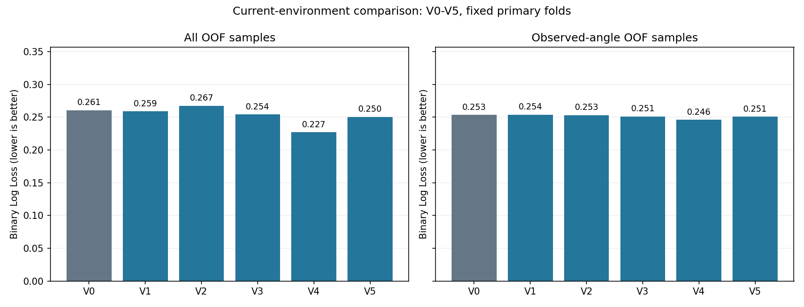
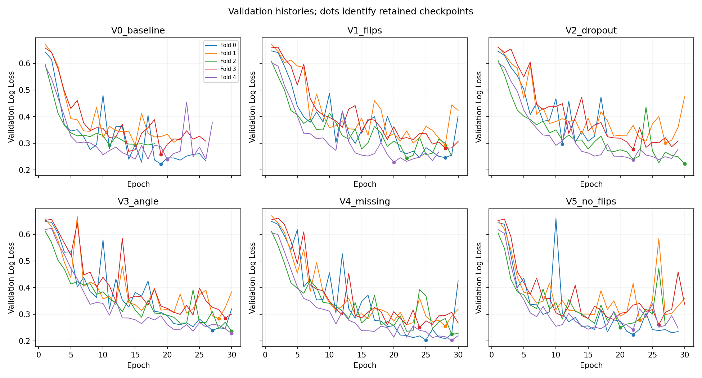

# Steps 7-8 measured results

Executed on 2026-11-15 using the baseline_v1 architecture. These V-series experiments are separate from the older E-series implementation. The preset plan was fixed before scored runs. All listed configurations completed five folds.

## Baseline reproduction and environment

The historical GitHub baseline scores 0.24638385; V0 in the current environment scores 0.26063203. An isolated run of the unchanged original train_baseline.py in this same environment scores 0.26063203, with maximum per-sample probability difference 1.11e-16 from V0. The historical score was not exactly reproduced here. Runtime/platform numerical differences remain a limitation; the specific component responsible has not been isolated. All claims about improvements below compare methods trained in this same environment. The original baseline_v1 files remain unchanged.

## Primary results

| experiment | oof_log_loss | fold_std_population | accuracy | observed_angle_log_loss | missing_angle_log_loss | parameters |
| --- | --- | --- | --- | --- | --- | --- |
| V0_baseline | 0.26063 | 0.02840 | 0.88778 | 0.25331 | 0.34163 | 60433 |
| V1_flips | 0.25878 | 0.02446 | 0.89589 | 0.25374 | 0.31450 | 60433 |
| V2_dropout | 0.26703 | 0.03152 | 0.88030 | 0.25297 | 0.42263 | 60433 |
| V3_angle | 0.25407 | 0.02481 | 0.89589 | 0.25114 | 0.28644 | 60609 |
| V4_missing | 0.22683 | 0.02258 | 0.90835 | 0.24584 | 0.01656 | 60625 |
| V5_no_flips | 0.25033 | 0.01859 | 0.89651 | 0.25057 | 0.24768 | 60609 |

Lowest pooled primary loss in this batch: **V4_missing, 0.22683**. This is a provisional development result, not a final competition score.

## Controlled comparisons and ablations

Negative loss change favors the modified configuration.

| comparison | reference | modified | loss_change | observed_angle_loss_change | folds_improved |
| --- | --- | --- | --- | --- | --- |
| Flips | V0_baseline | V1_flips | -0.00185 | 0.00043 | 2 |
| Dropout 0.25 to 0.40 | V1_flips | V2_dropout | 0.00826 | -0.00077 | 2 |
| Angle branch | V1_flips | V3_angle | -0.00471 | -0.00260 | 4 |
| Missing indicator | V3_angle | V4_missing | -0.02724 | -0.00530 | 5 |
| Flips in angle model | V5_no_flips | V3_angle | 0.00374 | 0.00058 | 2 |

- Flips: pooled loss is 0.00185 lower; 2/5 folds improve.
- Dropout 0.25 to 0.40: pooled loss is 0.00826 higher; 2/5 folds improve.
- Angle branch: pooled loss is 0.00471 lower; 4/5 folds improve.
- Missing indicator: pooled loss is 0.02724 lower; 5/5 folds improve.
- Flips in angle model: pooled loss is 0.00374 higher; 2/5 folds improve.

Dropout is the only regularization setting changed in V2; weight decay remains fixed. Angle fusion changes parameter count as well as providing metadata. Comparisons are conditional on the preset architecture/budget and one seed per fold, not universal conclusions or significance tests.

Adding the missing indicator changes observed-angle loss by -0.00530 and missing-angle loss by -0.26987. All missing-angle training samples are ships and test angles are complete. Therefore pooled loss alone is insufficient for final model selection.

## Conditional angle-group validation

The predefined trigger was met: the best angle variant changed primary loss by -0.03195 relative to V1; the threshold was -0.005.

| experiment | oof_log_loss | fold_std_population | observed_angle_log_loss | missing_angle_log_loss |
| --- | --- | --- | --- | --- |
| V1_flips | 0.27248 | 0.01936 | 0.26235 | 0.38443 |
| V3_angle | 0.27353 | 0.03529 | 0.27019 | 0.31056 |
| V4_missing | 0.23123 | 0.02041 | 0.25042 | 0.01896 |

- V3_angle versus V1 on grouped folds: pooled loss change +0.00106; observed-angle loss change +0.00783.

- V4_missing versus V1 on grouped folds: pooled loss change -0.04125; observed-angle loss change -0.01193.

These results use disjoint exact-angle groups (missing angles are singleton groups). Exact angles are only a proxy for acquisition relationships. Compare configurations within this table; do not pool scores with primary CV or interpret a change between splits as a causal estimate of leakage.

## Evidence, scope and handoff

- Each completed run has configurations/source/data/fold/environment hashes, fold scores, complete epoch histories, one OOF probability per training ID and best-checkpoint hashes. Raw data and weights are excluded from Git. Per-sample evidence and weights can be restored from the separate experiment bundle.
- Audit evidence: [metric and checkpoint verification](../results/steps78/verification.json) and [implementation tests](../results/steps78/tests.json).
- Normalization, angle imputation and scaling use only training-fold samples. Flips are training-only and aligned across the two channels.
- Validation labels choose best epochs and compare methods. The resulting selection optimism is not removed by OOF naming. No independent final test or nested CV was run. Fold standard deviation uses ddof=0 and is not a confidence interval.
- All variants share the 30-epoch cap and patience 7. Some may remain undertrained under this bounded budget. Concurrent execution times are not fair speed benchmarks.
- Detailed error analysis, final model selection/test prediction, assessed report and slides are subsequent tasks. No final submission or Top-5 claim is made, and no student contribution hours are invented.

